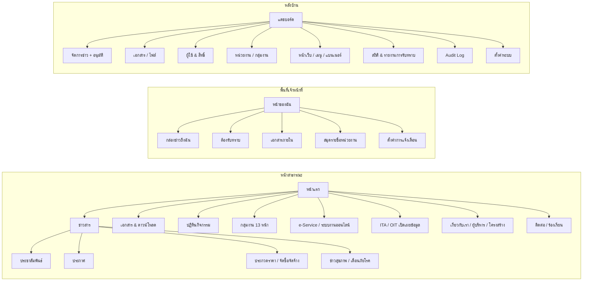
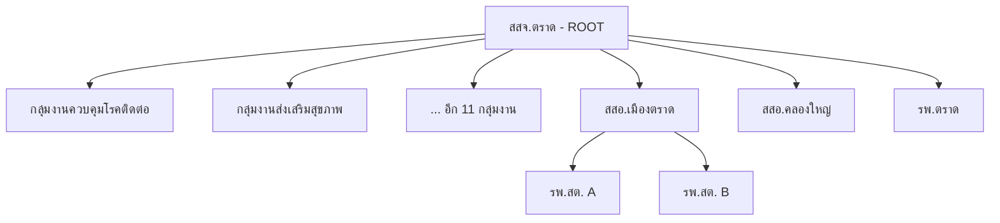
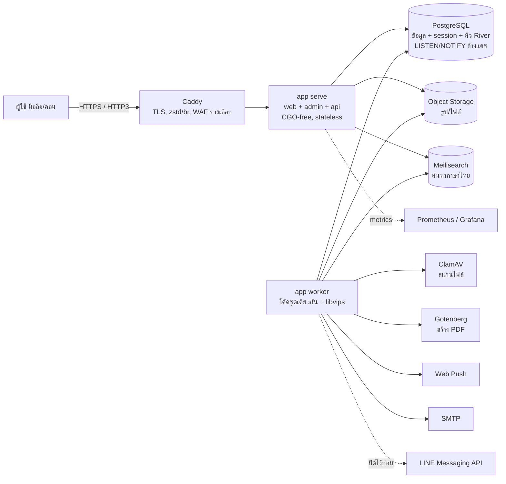
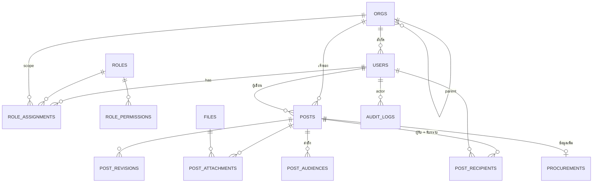
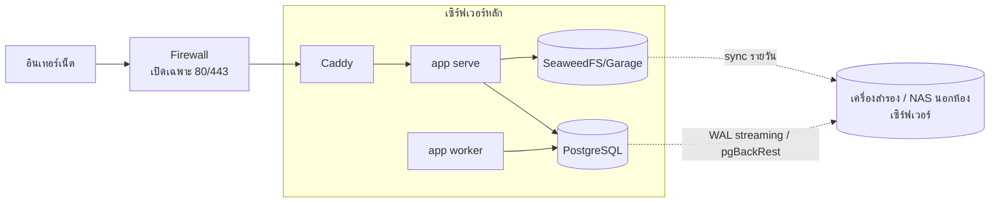
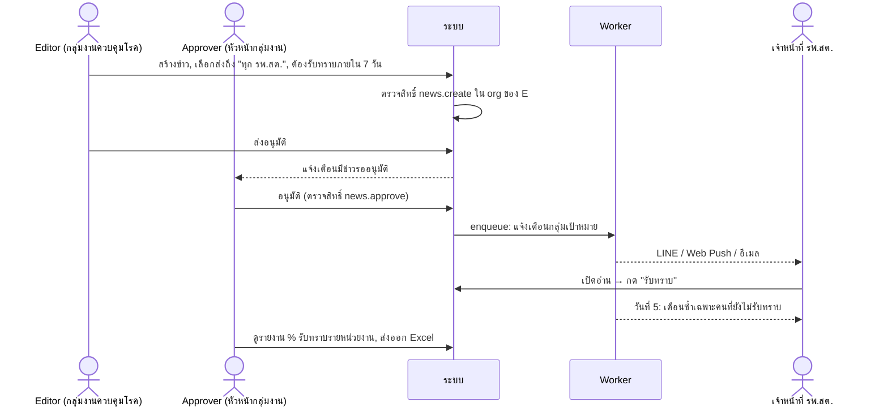
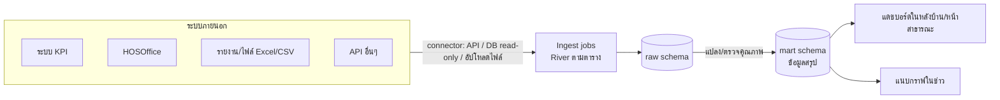

# แผนออกแบบระบบใหม่: เว็บแอปเผยแพร่ข่าวสารสาธารณสุข (Go)

> เอกสารเสนอแนวทางออกแบบใหม่ทั้งหมด แทนระบบ PHP เดิมใน `trat_health/`
> สถานะ: **ร่าง v4 — ปรับปรุงหลังทบทวนด้านความทันสมัย ความปลอดภัย ประสิทธิภาพ** (ดู [`REVIEW.md`](REVIEW.md))
> เอกสารคู่กัน: [`INTERNAL-SYSTEMS.md`](INTERNAL-SYSTEMS.md) — ระบบภายในสำหรับเจ้าหน้าที่ทำงานร่วมกัน (e-Office)
>
> สรุปการตัดสินใจ: ใช้ **เฉพาะ สสจ.ตราด จังหวัดเดียว** · **บังคับอนุมัติข่าวทุกกลุ่มงาน** · ติดตั้งบน **เซิร์ฟเวอร์ของหน่วยงานเอง** · LINE OA **ออกแบบไว้แต่ยังไม่เปิดใช้** · **สร้างใหม่ทั้งหมด ไม่ย้ายข้อมูลเดิม** · มี **ระบบเชื่อมและวิเคราะห์ข้อมูลจากระบบภายนอกของเราเอง**

---

## 1. สรุปผลสำรวจระบบเดิม

### 1.1 หน้าที่มีอยู่ (จากเมนูและไฟล์ใน repo)

| กลุ่ม | หน้า / ฟีเจอร์เดิม |
|---|---|
| ข่าวสาร | ประกาศ, ประชาสัมพันธ์, ประกวดราคา (ตาราง `posts_forum` แยกด้วย `main_category`), กรองตาม 13 กลุ่มงาน + ค้นหาชื่อเรื่อง |
| หลังบ้าน | `a_announce.php`, `a_relations.php`, `a_tender.php`, `post.php` (โพสต์ข่าว), `classes/delete.php` |
| ระบบงานออนไลน์ | ลิงก์ออก: ITA จังหวัด, KPI 43 แฟ้ม, สารบรรณ, ระบบจัดหาคอมพิวเตอร์, HOSOffice, HRTH ฯลฯ |
| เอกสาร | ดาวน์โหลดแบบฟอร์ม (ไฟล์ zip/pdf ใน `img/`), งบทดลอง, งานสาธารณสุขพื้นที่พิเศษ |
| บริการ | การขออนุญาตด้านยา (`medicine.php`) |
| เกี่ยวกับ | ประวัติ, ความเป็นมา, ติดต่อเรา |
| สมาชิก | สมัครสมาชิก / เข้าสู่ระบบเจ้าหน้าที่ (ใครก็สมัครได้) |

ไฟล์ที่ถูกอ้างถึงแต่ไม่มีใน repo: `index.php`, `post.php`, `login.php`, `register.php`, `medicine.php`, `new.php`, `includes/*`, `index.css`, ไฟล์ SQL

### 1.2 ปัญหาสำคัญที่ระบบใหม่ต้องแก้

| ปัญหา | ตัวอย่างในโค้ดเดิม | ผลกระทบ |
|---|---|---|
| **SQL Injection** | `classes/delete.php`: `"DELETE FROM posts_forum WHERE id = $id"` | ลบ/อ่านข้อมูลทั้งฐานได้ |
| **ไม่มีการตรวจสิทธิ์** | `delete.php` ไม่เช็ค session เลย, ลบด้วย GET | ใครก็ลบข่าวได้ผ่าน URL |
| ไม่มีระดับสิทธิ์ | ทุกคนที่สมัครได้ = โพสต์ได้ | ไม่มีขอบเขตกลุ่มงาน |
| รูปเก็บใน DB | `file_get_contents()` ลง BLOB + base64 ใน JSON | DB บวม ช้า แคชไม่ได้ |
| รหัสผ่าน DB ฝังโค้ด | `root` / รหัสว่าง ซ้ำใน 10+ ไฟล์ | ความปลอดภัย / ดูแลยาก |
| โค้ดซ้ำ | header/nav/เชื่อม DB ซ้ำทุกไฟล์ (~350 บรรทัด/ไฟล์) | แก้เมนูต้องแก้ 9 ไฟล์ |
| ไม่มี CSRF, ไม่มี audit log | — | ตรวจย้อนหลังไม่ได้ว่าใครทำอะไร |
| Accessibility | `<html lang="en">`, meta viewport พิมพ์ผิด (`ดูรายละเอียดport`) | มือถือแสดงผลผิด, screen reader อ่านผิดภาษา |
| ไม่มีระบบ "รับทราบ" | ข่าวเป็นแค่หน้าเว็บ | ไม่รู้ว่าเจ้าหน้าที่อ่านหนังสือเวียนแล้วหรือยัง |

---

## 2. เป้าหมายและผู้ใช้

### 2.1 เป้าหมาย
1. **เผยแพร่ข่าวสารเป็นหลัก** — ส่งถึงคนที่ใช่ (ตามระดับ/หน่วยงาน) และรู้ว่าใครอ่านแล้ว
2. **ทุกวัยใช้ได้** — ตัวอักษรใหญ่ คอนทราสต์สูง ปุ่มใหญ่ ภาษาง่าย มือถือก่อน (WCAG 2.2 AA)
3. **เร็วบนเน็ตช้า/มือถือรุ่นเก่า** — หน้าแรก < 100 KB JS, โหลด < 2 วินาทีบน 3G
4. **แอดมินแบ่งขอบเขต** — แต่ละกลุ่มงาน/หน่วยงานดูแลเฉพาะของตัวเอง, Super Admin ทำได้ทุกอย่าง
5. **ปลอดภัยตามมาตรฐานภาครัฐ** — PDPA, audit log, รองรับเกณฑ์ ITA / มาตรฐานเว็บไซต์ภาครัฐ (DGA)

### 2.2 ผู้ใช้ (Personas)

| ผู้ใช้ | ตัวอย่าง | ใช้ทำอะไร |
|---|---|---|
| ประชาชนทั่วไป (ไม่ล็อกอิน) | ผู้สูงอายุ, ผู้ปกครอง, ผู้ประกอบการ | อ่านประชาสัมพันธ์, ประกาศ, ประกวดราคา, ดาวน์โหลดแบบฟอร์ม, ข้อมูล ITA |
| เจ้าหน้าที่ระดับจังหวัด | สสจ. 13 กลุ่มงาน | อ่าน/รับทราบหนังสือเวียน, เขียนข่าวกลุ่มงานตัวเอง |
| เจ้าหน้าที่ระดับอำเภอ | สสอ. | รับข่าวจากจังหวัด, ส่งต่อถึง รพ.สต. ในอำเภอ |
| เจ้าหน้าที่ระดับหน่วยบริการ | รพ., รพ.สต. | รับข่าว, รับทราบ, ดาวน์โหลดเอกสารภายใน |
| อสม. (ระยะต่อไป) | อาสาสมัคร | รับข่าวสั้นแบบเข้าใจง่ายผ่าน LINE |
| ผู้บริหาร | นพ.สสจ., หัวหน้ากลุ่มงาน | อนุมัติข่าว, ดูสถิติการรับทราบ |
| แอดมิน | แอดมินกลุ่มงาน / Super Admin | จัดการเนื้อหา ผู้ใช้ สิทธิ์ ในขอบเขต |

---

## 3. แผนผังเว็บไซต์ (Sitemap)



### 3.1 หน้าสาธารณะ

| หน้า | URL | เนื้อหาหลัก |
|---|---|---|
| หน้าแรก | `/` | แบนเนอร์ด่วน (เตือนภัยโรค), ข่าวเด่น 3 ข่าว, แท็บ ประชาสัมพันธ์/ประกาศ/ประกวดราคา, ทางลัดบริการ (ไอคอนใหญ่), กิจกรรมใกล้ถึง, ลิงก์ ITA |
| รายการข่าว | `/news`, `/news?type=announce&dept=ncd` | กรองตามประเภท/กลุ่มงาน/ปี, ค้นหา, แบ่งหน้า |
| อ่านข่าว | `/news/{slug}` | เนื้อหา, ไฟล์แนบ (PDF แสดงในหน้า), แกลเลอรี, แชร์ LINE/Facebook, ปุ่ม "ฟังข่าว" (Text-to-Speech), ปุ่มพิมพ์ |
| ประกวดราคา | `/procurement` | ตาราง: เลขที่, เรื่อง, วงเงิน, วันยื่นซอง, สถานะ, ลิงก์ e-GP, ผลการพิจารณา |
| เอกสาร | `/documents` | หมวดหมู่, ค้นหา, เวอร์ชันล่าสุด, จำนวนดาวน์โหลด |
| ปฏิทิน | `/events` | มุมมองเดือน/รายการ, เพิ่มลง Google Calendar (.ics) |
| กลุ่มงาน | `/departments/{slug}` | หน้าที่, หัวหน้า, ช่องทางติดต่อ, ข่าวล่าสุดของกลุ่มงาน |
| หน่วยบริการ | `/units` | รายชื่อ รพ./สสอ./รพ.สต. + แผนที่ + เบอร์โทร |
| e-Service | `/services` | การขออนุญาตด้านยา และลิงก์ระบบภายนอก (จัดการได้จากหลังบ้าน) |
| ITA | `/ita` | รายการตัวชี้วัด OIT ประจำปี ลิงก์ไปยังข่าว/เอกสารที่เกี่ยวข้อง |
| เกี่ยวกับเรา | `/about`, `/about/history`, `/about/executives`, `/about/structure` | หน้าเนื้อหาแก้ไขได้จากหลังบ้าน |
| ติดต่อ / ร้องเรียน | `/contact` | ข้อมูลติดต่อ, แผนที่, แบบฟอร์มร้องเรียน (มีเลขติดตาม) |
| ค้นหารวม | `/search?q=` | ค้นข่าว + เอกสาร + หน้าเว็บ (รองรับการตัดคำไทย) |
| นโยบาย | `/privacy`, `/accessibility`, `/sitemap` | PDPA, คำประกาศการเข้าถึง, แผนผังเว็บ |

### 3.2 พื้นที่เจ้าหน้าที่ (ต้องล็อกอิน)

| หน้า | URL | เนื้อหา |
|---|---|---|
| หน้าของฉัน | `/me` | ข่าวถึงฉันที่ยังไม่อ่าน, รายการที่ต้องรับทราบ (มีกำหนดเวลา), กิจกรรมของฉัน |
| กล่องข่าว | `/me/inbox` | ข่าว/หนังสือเวียนที่ส่งถึงระดับ/หน่วยงานของฉัน, ติดดาว, ค้นหา |
| รับทราบ | ปุ่มในหน้าข่าว | กด "รับทราบ" ครั้งเดียว บันทึกเวลา |
| เอกสารภายใน | `/me/documents` | เอกสารที่จำกัดสิทธิ์ตามระดับ |
| สมุดรายชื่อ | `/me/directory` | หน่วยงาน/ผู้ประสานงาน (เฉพาะข้อมูลที่ยินยอมเปิดเผย) |
| ตั้งค่า | `/me/settings` | ผูก LINE, เปิด Web Push, ขนาดตัวอักษร, ธีม, Passkey |

### 3.3 หลังบ้าน (`/admin`)

| เมนู | ความสามารถ |
|---|---|
| แดชบอร์ด | ข่าวรออนุมัติ, ยอดอ่าน 7 วัน, % รับทราบของหนังสือเวียนล่าสุด (เห็นเฉพาะขอบเขตตัวเอง) |
| ข่าว | สร้าง/แก้/ลบ, ตัวแก้ไขแบบบล็อก, ตั้งเวลาเผยแพร่/หมดอายุ, ปักหมุด, เลือกกลุ่มเป้าหมาย, ต้องรับทราบหรือไม่, ประวัติเวอร์ชัน |
| อนุมัติ | คิวข่าวรออนุมัติของกลุ่มงาน, อนุมัติ/ตีกลับพร้อมความเห็น |
| ประกวดราคา | ฟอร์มเฉพาะ (เลขที่, วงเงิน, วันที่, ผลประกาศ) |
| เอกสาร/ไฟล์ | คลังไฟล์, หมวดหมู่, สิทธิ์การเข้าถึง, แทนที่เวอร์ชัน |
| ปฏิทิน | กิจกรรม/ประชุม |
| ผู้ใช้ | เชิญผู้ใช้, อนุมัติคำขอสมัคร, กำหนดบทบาทในขอบเขต, ระงับบัญชี |
| หน่วยงาน | ต้นไม้หน่วยงาน (จังหวัด → อำเภอ → หน่วยบริการ) และกลุ่มงาน |
| หน้าเว็บ/เมนู | หน้า static, เมนู, แบนเนอร์, ลิงก์ระบบภายนอก (Super Admin) |
| ITA | ผูกข่าว/เอกสารเข้ากับตัวชี้วัด OIT แต่ละข้อ |
| ร้องเรียน | รับเรื่อง, มอบหมายกลุ่มงาน, ตอบกลับ |
| สถิติ | ยอดอ่าน, ยอดดาวน์โหลด, รายงานใครยังไม่รับทราบ (ส่งออก Excel) |
| Audit Log | ใคร ทำอะไร กับอะไร เมื่อไร จาก IP ใด (อ่านอย่างเดียว) |
| ตั้งค่า | ชื่อเว็บ, โลโก้, LINE OA token, SMTP, นโยบายรหัสผ่าน (Super Admin) |

---

## 4. ระบบสิทธิ์แบบแบ่งขอบเขต (Scoped RBAC) ⭐

หัวใจของข้อกำหนด "แอดมินแต่ละแผนกควบคุมได้ทั้งหมดในขอบเขตตัวเอง และมีแอดมินสูงสุดทำได้ทุกอย่าง"

### 4.1 แนวคิด: สิทธิ์ = บทบาท × ขอบเขต

```
ผู้ใช้ ──< role_assignments >── บทบาท (role)
                 │
                 └── ขอบเขต (scope) = หน่วยงาน/กลุ่มงานหนึ่งโหนดในต้นไม้
                                    (+ include_children: ครอบคลุมหน่วยงานลูกด้วยหรือไม่)
```

- **จังหวัดเดียว (สสจ.ตราด)**: รากของต้นไม้คือ สสจ.ตราด ไม่ทำ multi-tenant (ลดความซับซ้อน) — ถ้าวันหน้าต้องขยาย โครงต้นไม้หน่วยงานรองรับการเพิ่มชั้นบนได้โดยไม่ต้องรื้อ
- ผู้ใช้ 1 คน มีได้ **หลายบทบาทในหลายขอบเขต** เช่น เป็น Editor ของ "กลุ่มงานควบคุมโรคติดต่อ" และ Viewer ของ "สสอ.เมือง"
- หน่วยงานเป็น **ต้นไม้** (ltree / closure table) ทำให้ "แอดมิน สสอ.เมือง" ครอบคลุม รพ.สต. ทุกแห่งในอำเภอเมืองอัตโนมัติ



### 4.2 บทบาทมาตรฐาน

| บทบาท | ขอบเขต | ทำอะไรได้ |
|---|---|---|
| **Super Admin** | ทั้งระบบ | ทุกอย่าง: ตั้งค่าระบบ, จัดการหน่วยงาน, แต่งตั้ง Unit Admin, ดู audit log, กู้คืนข้อมูลที่ลบ |
| **Unit Admin** (แอดมินกลุ่มงาน/หน่วยงาน) | หน่วยงานของตน (+ลูก) | ทุกอย่าง *ภายในขอบเขต*: ข่าว, เอกสาร, ปฏิทิน, อนุมัติ, เพิ่ม/ลบผู้ใช้ในหน่วยงาน, มอบบทบาท Editor/Approver, ดูสถิติ & audit log ของขอบเขต |
| **Approver** | หน่วยงานของตน | อนุมัติ/ตีกลับ/เผยแพร่ข่าว |
| **Editor** | หน่วยงานของตน | สร้าง/แก้ข่าวและเอกสารของตน → ส่งอนุมัติ (เผยแพร่เองไม่ได้) |
| **Staff** | หน่วยงานของตน | อ่านข่าวภายใน, รับทราบ, ดาวน์โหลดเอกสารภายใน |
| (ไม่ล็อกอิน) | — | อ่านเนื้อหาสาธารณะ |

กฎสำคัญ:
1. **ห้ามมอบสิทธิ์เกินตัว** — Unit Admin มอบได้เฉพาะบทบาทที่ต่ำกว่าตน และเฉพาะในขอบเขตตน
2. **ห้ามข้ามขอบเขต** — แอดมินกลุ่มงาน A แก้ข่าวกลุ่มงาน B ไม่ได้ แม้รู้ ID (ตรวจที่ชั้น service ไม่ใช่แค่ซ่อนปุ่ม)
3. **ส่งข่าวข้ามหน่วยงานได้ แต่เป็นเจ้าของไม่ได้** — กลุ่มงานควบคุมโรคส่งหนังสือเวียนถึง "ทุก รพ.สต." ได้ แต่ข่าวยังเป็นของกลุ่มงานควบคุมโรค
4. **Super Admin ต้องมีอย่างน้อย 2 คน** และต้องใช้ 2FA/Passkey บังคับ
5. **บังคับอนุมัติทุกกลุ่มงาน (ปิดไม่ได้)** — ข่าวทุกชิ้นต้องผ่าน `pending → approved` ก่อนเผยแพร่ และ **ห้ามอนุมัติข่าวที่ตัวเองเขียน** (แม้เป็น Unit Admin/Super Admin) ข่าวด่วน/เตือนภัยมีช่อง "อนุมัติด่วน" ที่แจ้งเตือน Approver ทุกคนในขอบเขตพร้อมกัน แต่ยังต้องมีคนที่ 2 กดอนุมัติ แก้ไขข่าวที่เผยแพร่แล้ว = สร้าง revision ใหม่ที่ต้องอนุมัติอีกครั้ง — ถ้าในหน่วยงานไม่มี Approver คนอื่น (เช่น รพ.สต. ที่มีเจ้าหน้าที่น้อย) งานจะ **ส่งขึ้นหน่วยงานแม่อัตโนมัติ** (รพ.สต. → สสอ.) ไม่ให้ข่าวค้าง
6. **การกระทำเสี่ยงต้องยืนยันตัวตนซ้ำ (step-up)** — มอบบทบาท, ลบ, เปลี่ยนตั้งค่า, ลงนาม ต้องยืนยัน Passkey/OTP อีกครั้งแม้ล็อกอินอยู่
7. **ทุกการกระทำในหลังบ้านลง audit log** (append-only)

### 4.3 สิทธิ์ละเอียด (Permissions)

บทบาทคือชุดของ permission — เก็บใน DB เพื่อให้ Super Admin ปรับได้โดยไม่แก้โค้ด

```
news.read_internal   news.create   news.update.own   news.update.any
news.publish         news.delete   news.approve
doc.upload           doc.delete    event.manage
user.invite          user.manage   role.assign
stats.view           audit.view    settings.manage   org.manage
```

### 4.4 การตรวจสิทธิ์ในโค้ด Go

```go
// internal/authz/authz.go
type Authorizer interface {
    // Can ตอบว่าผู้ใช้ทำ perm กับทรัพยากรที่อยู่ใน orgID ได้หรือไม่
    Can(ctx context.Context, u *auth.User, perm Permission, orgID uuid.UUID) bool
    // ScopeOrgIDs คืนรายการ org ทั้งหมดที่ผู้ใช้มี perm (ใช้กรอง query รายการ)
    ScopeOrgIDs(ctx context.Context, u *auth.User, perm Permission) ([]uuid.UUID, bool /*all*/)
}

// ใน service — ตรวจทุกครั้งก่อนเขียน
func (s *NewsService) Update(ctx context.Context, id uuid.UUID, in UpdateInput) error {
    u := auth.MustUser(ctx)
    post, err := s.repo.Get(ctx, id)
    if err != nil { return err }
    if !s.authz.Can(ctx, u, authz.NewsUpdateAny, post.OwnerOrgID) &&
       !(post.AuthorID == u.ID && s.authz.Can(ctx, u, authz.NewsUpdateOwn, post.OwnerOrgID)) {
        return ErrForbidden
    }
    ...
}
```

สิทธิ์ของผู้ใช้ถูกคำนวณครั้งเดียวต่อ request แล้วแคชใน context (และแคชในหน่วยความจำ 60 วินาที invalidate เมื่อมีการเปลี่ยนบทบาท)

---

## 5. ระบบหลัก (Modules)

| # | ระบบ | รายละเอียด | ระยะ |
|---|---|---|---|
| 1 | **ข่าวสาร (CMS)** | ประเภท: ประชาสัมพันธ์ / ประกาศ / ประกวดราคา / หนังสือเวียน / เตือนภัย; สถานะ `draft → pending → published → archived`; ตั้งเวลา; ปักหมุด; แท็ก; ประวัติเวอร์ชัน; slug ภาษาไทย | 1 |
| 2 | **การกำหนดกลุ่มเป้าหมาย** | ส่งถึง: สาธารณะ / เจ้าหน้าที่ทั้งหมด / ระดับ (จังหวัด/อำเภอ/หน่วยบริการ) / หน่วยงานเจาะจง / ตำแหน่ง | 1 |
| 3 | **ระบบรับทราบ (Acknowledgement)** | ข่าวที่ "ต้องรับทราบ" มีกำหนดเวลา; รายงานรายหน่วยงาน; เตือนซ้ำอัตโนมัติคนที่ยังไม่รับทราบ | 1 |
| 4 | **ผู้ใช้ & Scoped RBAC** | ตามหัวข้อ 4; สมัครแล้วต้องรอ Unit Admin อนุมัติ (ไม่ใช่สมัครแล้วโพสต์ได้ทันทีแบบเดิม) | 1 |
| 5 | **คลังเอกสาร/ไฟล์** | Object storage, สแกนชนิดไฟล์, ย่อรูปเป็น WebP/AVIF อัตโนมัติ, ตัวอย่าง PDF, สิทธิ์ระดับไฟล์ | 1 |
| 6 | **ค้นหา** | ค้นภาษาไทยได้ถูกต้อง (ตัดคำ), กรองประเภท/กลุ่มงาน/ปี | 1 |
| 7 | **แจ้งเตือนหลายช่องทาง** | Web Push (PWA), อีเมล, แจ้งเตือนในเว็บ; ผู้ใช้เลือกช่องทางเอง — **LINE OA ออกแบบเป็น adapter ไว้แล้ว แต่ปิดด้วย feature flag** * | 2 |
| 8 | **ประกวดราคา/จัดซื้อจัดจ้าง** | ฟิลด์เฉพาะ + ลิงก์ e-GP + สรุปผลรายเดือน (ใช้กับ ITA) | 1 |
| 9 | **ปฏิทินกิจกรรม** | กิจกรรม/ประชุม, export .ics | 2 |
| 10 | **ITA / OIT** | ผูกเนื้อหาเข้าตัวชี้วัดรายปี ทำหน้า `/ita` อัตโนมัติ | 2 |
| 11 | **ร้องเรียน/ติดต่อ** | แบบฟอร์ม + เลขติดตาม + มอบหมายกลุ่มงาน | 2 |
| 12 | **สถิติ** | ยอดอ่าน (ไม่เก็บข้อมูลส่วนบุคคลของผู้อ่านสาธารณะ), ยอดดาวน์โหลด, อัตรารับทราบ | 2 |
| 13 | **Audit Log** | append-only + hash chain, ค้นหาได้, เก็บ ≥ 2 ปี | 1 |
| 14 | **หน้าเว็บ/เมนู/แบนเนอร์** | จัดการหน้า static และลิงก์ระบบภายนอกจากหลังบ้าน (ไม่ต้องแก้โค้ด) | 1 |
| 15 | **API สาธารณะ + RSS** | `/api/v1/*` JSON, RSS/Atom ต่อกลุ่มงาน — รองรับแอปมือถือ/หน่วยงานอื่นดึงข่าว | 3 |
| 16 | **ฟังข่าว (TTS)** | ปุ่มอ่านออกเสียง (Web Speech API ฝั่งเบราว์เซอร์ ไม่มีค่าใช้จ่าย) สำหรับผู้สูงอายุ | 2 |
| 17 | **เชื่อมข้อมูล & วิเคราะห์ (Data Hub)** | ดึงข้อมูลจากระบบภายนอก (KPI, HOSOffice, รายงาน ฯลฯ) มาเก็บและวิเคราะห์เอง แสดงแดชบอร์ด — ดูหัวข้อ 9.3 | 3 |

\* LINE Notify ปิดบริการแล้วตั้งแต่ 31 มี.ค. 2025 — เมื่อพร้อมเปิดใช้ต้องใช้ LINE Messaging API ผ่าน LINE OA ของหน่วยงาน (ตั้งค่า token แยกต่อจังหวัดได้)

---

## 6. สถาปัตยกรรมทางเทคนิค

### 6.1 หลักการ
- **Modular Monolith ด้วย Go** — ไบนารีเดียว deploy ง่าย ทีมเล็กดูแลได้ แต่แบ่งโมดูลชัดเจน แยกเป็น service ได้ภายหลังถ้าจำเป็น (ไม่เริ่มด้วย microservices — เกินความจำเป็นสำหรับระดับจังหวัด)
- **Server-Side Rendering เป็นหลัก** — HTML เรนเดอร์จาก Go โดยตรง: เร็วบนมือถือเก่า, SEO ดี, screen reader ทำงานได้ดี, ใช้ JS น้อย
- **Progressive Enhancement** — ใช้งานได้แม้ JS ปิด; htmx เพิ่มความลื่นไหล

### 6.2 Tech Stack ที่แนะนำ

| ชั้น | เลือกใช้ | เหตุผล |
|---|---|---|
| ภาษา | **Go 1.25+** (ตามเวอร์ชันเสถียรล่าสุดเสมอ) — ใช้ของใหม่ในไลบรารีมาตรฐาน: `http.CrossOriginProtection` (กัน CSRF), `os.Root` (กัน path traversal ตอนอ่าน/เขียนไฟล์), `go tool` ใน `go.mod` (ล็อกเวอร์ชัน templ/sqlc/goose), `testing/synctest` (ทดสอบงานตั้งเวลา) | เร็ว, ใช้หน่วยความจำน้อย, ไบนารีเดียว, concurrency ดีสำหรับส่งแจ้งเตือนจำนวนมาก |
| HTTP router | `net/http` (ServeMux แบบมี method/pattern) + middleware เล็กๆ | ไม่ต้องพึ่ง framework ใหญ่; ถ้าต้องการ group route ใช้ `chi` |
| Template | **templ** | type-safe, compile-time check, เป็นคอมโพเนนต์ได้ |
| Interactivity | **htmx 2** (ปิด `allowEval`, ไม่ใช้ `hx-on`) + **Alpine.js รุ่น CSP** (`@alpinejs/csp`) | ใช้ CSP เข้มงวดได้ (ไม่ต้องเปิด `unsafe-eval`); ไม่ต้องมี SPA; รวม JS < 40 KB; ใช้ View Transitions API ให้เปลี่ยนหน้าลื่น |
| CSS | **Tailwind CSS v4** (standalone CLI) | ไม่ต้องใช้ Node, ได้ design token, CSS สุดท้ายเล็ก |
| ตัวแก้ไขข่าว (หลังบ้าน) | **Tiptap** โหลดเฉพาะหน้า editor, bundle ด้วย **esbuild ผ่าน Go API** ตอน build (esbuild เขียนด้วย Go — ไม่ต้องติดตั้ง Node) | เก็บเป็น JSON บล็อก → เรนเดอร์ HTML ฝั่ง Go จาก whitelist ของบล็อก (ไม่เก็บ HTML ดิบ) |
| ฐานข้อมูล | **PostgreSQL** | JSONB, ltree (ต้นไม้หน่วยงาน), full-text, เสถียร |
| Data access | **sqlc** + **pgx/v5** | SQL ตรงๆ แต่ type-safe, ไม่มี ORM magic |
| Migration | **goose** (หรือ golang-migrate) | ฝัง migration ในไบนารี |
| Job queue | **River** (คิวบน Postgres) | ส่งแจ้งเตือน, ย่อรูป, เผยแพร่ตามเวลา — ไม่ต้องมี Redis/RabbitMQ เพิ่ม |
| ค้นหาภาษาไทย | **Meilisearch ตั้งแต่ระยะ 1** (ไบนารีเดียว ตัดคำไทยได้ ทนพิมพ์ผิด) — Postgres `pg_trgm` เป็นทางสำรองเมื่อ Meilisearch ล่ม; ระยะ 4 เพิ่ม **ค้นหาตามความหมาย** (pgvector + โมเดล embedding รันบน CPU ในเครื่อง) | ภาษาไทยไม่มีช่องว่างระหว่างคำ — FTS ของ Postgres ใช้ไม่ได้ดี และการค้นหาเป็นหัวใจของเว็บข่าว/เอกสาร จึงไม่ควรรอถึงระยะ 3 |
| ไฟล์ | S3-compatible object storage ติดตั้งบนเซิร์ฟเวอร์เอง (**SeaweedFS** หรือ **Garage**) — เริ่มเล็กสุดใช้ดิสก์ในเครื่องผ่าน interface เดียวกัน | แยกไฟล์ออกจาก DB, ย้ายไปที่เก็บอื่นได้โดยไม่แก้โค้ด |
| ย่อรูป | `govips` (libvips) **รันเฉพาะใน worker** | เร็ว ใช้ RAM น้อย, สร้าง WebP/AVIF หลายขนาด, **ลบ EXIF/GPS** ออกจากรูป (PDPA); แยกจาก web เพื่อให้ไบนารีเว็บ build แบบ CGO-free และรูปที่ประกอบมาร้ายไม่กระทบ web |
| สแกนไวรัส | **ClamAV** (clamd) container แยก | ทุกไฟล์ที่อัปโหลดถูกสแกนก่อนเปิดให้ดาวน์โหลด (สถานะ `pending_scan → clean/quarantined`) |
| สร้าง PDF | **Gotenberg** (Chromium) container แยก, จำกัดงานพร้อมกัน | ตัดคำ/จัดรูปภาษาไทยถูกต้อง; แยกออกเพราะ Chromium กิน RAM และมีพื้นที่โจมตีกว้าง |
| Session | Cookie + ตาราง session ใน Postgres (`scs` + pgxstore) | ยกเลิก session ได้ทันที (ต่างจาก JWT) |
| Auth | รหัสผ่าน (argon2id) + **Passkey (WebAuthn)** + TOTP; ออกแบบ identity provider แบบเสียบเพิ่มได้ (OIDC) เพื่อรองรับ **Provider ID** ภายหลัง (หัวข้อ 9.2) | ผู้สูงอายุใช้ Passkey ง่ายกว่าจำรหัส |
| แจ้งเตือน | LINE Messaging API, Web Push (VAPID), SMTP | |
| Observability | `log/slog` (JSON), OpenTelemetry, Prometheus `/metrics`, Grafana | เริ่มจาก Prometheus + Grafana + แจ้งเตือนก่อน, tracing/Loki เพิ่มเมื่อจำเป็น (ทีมเล็กไม่ต้องดูแลหลายระบบตั้งแต่วันแรก) |
| Reverse proxy | **Caddy** (+ ปลั๊กอิน Coraza WAF + OWASP CRS เป็นทางเลือก) | HTTPS อัตโนมัติ, HTTP/2–3, บีบอัด zstd/br; Caddy ไม่มีแคชในตัว — แคชทำในแอป (หัวข้อ 6.7) |
| Deploy | **เซิร์ฟเวอร์ของหน่วยงานเอง**: Docker Compose (หรือ systemd + ไบนารีเดียว) — ดูหัวข้อ 6.8 | ไม่ผูกกับ cloud รายใด |
| CI/CD | GitHub Actions: `go vet`, `golangci-lint`, `govulncheck`, test (+ `-race`), **SBOM** (syft), **สแกน image** (Trivy/Grype), **ลงนาม image** (cosign), Renovate อัปเดต dependency อัตโนมัติ | ป้องกัน supply-chain และรู้ทันทีเมื่อไลบรารีมีช่องโหว่ |

### 6.3 ภาพรวมระบบ



- โค้ดชุดเดียว (monorepo) build เป็น 2 image: `app serve` (เว็บ, ไม่มี CGO, image เล็ก) และ `app worker` (งานเบื้องหลัง + libvips) — `app migrate` รันก่อน deploy
- Static assets ฝังด้วย `embed` + ชื่อไฟล์มี hash → แคช 1 ปี
- ClamAV, Gotenberg, Meilisearch, DB, storage อยู่ในเครือข่ายภายในของ Docker เท่านั้น ไม่เปิดพอร์ตออกนอกเครื่อง

### 6.4 โครงสร้างโปรเจกต์

```
/
├── cmd/app/main.go              # entrypoint: serve | worker | migrate | seed
├── internal/
│   ├── platform/                # config, db, logger, storage, mailer, otel
│   ├── auth/                    # login, session, passkey, totp
│   ├── authz/                   # scoped RBAC (หัวข้อ 4)
│   ├── org/                     # ต้นไม้หน่วยงาน/กลุ่มงาน
│   ├── user/
│   ├── news/                    # ข่าว, workflow, เวอร์ชัน, กลุ่มเป้าหมาย
│   ├── ack/                     # ระบบรับทราบ
│   ├── document/
│   ├── procurement/
│   ├── event/
│   ├── notify/                  # LINE, web push, email (ผ่าน River jobs)
│   ├── search/
│   ├── ita/
│   ├── complaint/
│   ├── audit/
│   ├── datahub/                 # connector ดึงข้อมูลภายนอก + แดชบอร์ด (ระยะ 3)
│   └── web/
│       ├── public/              # handler หน้าสาธารณะ
│       ├── staff/               # handler พื้นที่เจ้าหน้าที่
│       ├── admin/               # handler หลังบ้าน
│       ├── api/                 # JSON API v1
│       ├── middleware/          # auth, csrf, ratelimit, secure headers, request-id
│       └── views/               # templ components + layouts
├── db/
│   ├── migrations/              # *.sql (goose)
│   └── queries/                 # *.sql (sqlc)
├── assets/                      # tailwind input, htmx, alpine, icons, fonts
├── deploy/                      # Dockerfile, compose.yaml, Caddyfile
└── docs/
```

แต่ละโมดูลมี 3 ชั้น: `handler` (HTTP) → `service` (business rule + **ตรวจสิทธิ์**) → `repo` (sqlc) — ห้าม handler เรียก repo ตรง

### 6.5 แบบจำลองข้อมูล (หลัก)



| ตาราง | ฟิลด์สำคัญ |
|---|---|
| `orgs` | id, parent_id, path (ltree), type (`province`/`department`/`district`/`hospital`/`subdistrict_hospital`), name, slug, code (รหัสหน่วยบริการ 5 หลัก) |
| `users` | id, org_id, email, phone, name, position, status (`pending`/`active`/`suspended`), password_hash, line_user_id, prefs (jsonb) |
| `roles` / `role_permissions` | บทบาท และชุด permission |
| `role_assignments` | user_id, role_id, org_id (null = ทั้งระบบ), include_children, granted_by, expires_at |
| `posts` | id (UUIDv7 — เรียงตามเวลา, index ดีกว่า UUIDv4), type, status, owner_org_id, author_id, title, slug, summary, body (jsonb), cover_file_id, visibility (`public`/`internal`), requires_ack, ack_deadline, publish_at, expire_at, pinned_until, workflow_instance_id |
| `post_audiences` | post_id, target_type (`all_staff`/`org`/`org_tree`/`org_type`/`position`), target_value |
| `post_recipients` | post_id, user_id, delivered_at, read_at, acked_at — **สร้างรายชื่อผู้รับ ณ เวลาเผยแพร่** (snapshot) ทำให้รายงาน "ใครยังไม่รับทราบ" ถูกต้องแม้ภายหลังมีคนย้ายหน่วยงาน และ query เร็ว (index ตรง) |
| `post_revisions` | post_id, version, body, edited_by, created_at |
| `files` | id, owner_org_id, storage_key, mime, size, sha256, variants (jsonb), visibility |
| `procurements` | post_id, ref_no, budget, method, submit_deadline, egp_url, result, winner |
| `events`, `documents`, `complaints`, `ita_items` | ตามโมดูล |
| `audit_logs` | id, actor_id, action, entity, entity_id, org_id, diff (jsonb), ip, ua, at, prev_hash, hash — **ไม่มี UPDATE/DELETE** (บังคับด้วย DB permission) + **hash chain** ตรวจได้ว่าถูกแก้ย้อนหลังหรือไม่; แบ่ง partition รายเดือน |
| `page_views_daily` | entity, entity_id, day, count — นับยอดอ่านแบบรวมในหน่วยความจำแล้ว flush ทุก 1 นาที (ไม่ UPDATE แถวเดียวทุกครั้งที่มีคนอ่าน ซึ่งทำให้ DB คอขวดตอนข่าวด่วน) |

ลบข้อมูลใช้ **soft delete** (`deleted_at`) — Super Admin กู้คืนได้ภายใน 30 วัน

### 6.6 ความปลอดภัย

ออกแบบตามแนว **OWASP ASVS ระดับ 2** และหลัก "ป้องกันหลายชั้น" — ถ้าชั้นหนึ่งพลาด ชั้นถัดไปยังกันได้

**ก. ตัวตนและ session**
- รหัสผ่าน argon2id, ความยาวขั้นต่ำ 12 ตัว (ไม่บังคับอักขระพิเศษแบบเก่า — ตามแนว NIST 800-63B), ตรวจกับรายการรหัสผ่านที่รั่วแบบ offline
- **Passkey เป็นทางหลัก**, TOTP สำรอง; **บังคับ 2 ชั้นสำหรับทุกบทบาทที่มีสิทธิ์เขียน**
- Session: cookie `__Host-` + `HttpOnly` + `Secure` + `SameSite=Lax`, **เปลี่ยน session ID ทุกครั้งที่ล็อกอิน/ยกระดับสิทธิ์**, หมดอายุเมื่อไม่ใช้งาน 30 นาที (หลังบ้าน) / 8 ชม. (ทั่วไป) และหมดอายุสูงสุด 7 วัน, ผู้ใช้ดูและสั่งออกจากระบบทุกอุปกรณ์ได้
- **Step-up**: การกระทำเสี่ยงต้องยืนยันตัวตนซ้ำ (หัวข้อ 4.2)
- ข้อความล็อกอินผิดเหมือนกันทุกกรณี (กันการเดาว่ามีบัญชีหรือไม่), rate limit ต่อ IP และต่อบัญชี
- บัญชีฉุกเฉิน (break-glass) 1 บัญชี เก็บรหัสในซองปิดผนึก ใช้เมื่อ Super Admin ทุกคนเข้าไม่ได้ — ใช้แล้วแจ้งเตือนทุกคน

**ข. สิทธิ์ (กัน IDOR / ข้ามขอบเขต)**
- ฟังก์ชัน repo ที่คืนข้อมูลหลายแถว **ต้องรับพารามิเตอร์ `authz.Scope`** (type ของ Go) — ลืมกรองขอบเขตแล้วโค้ด compile ไม่ผ่าน
- ทดสอบอัตโนมัติ: ทุก endpoint ถูกยิงด้วยผู้ใช้ต่างขอบเขต ต้องได้ 403/404 ทุกครั้ง (ตาราง test สร้างจากรายการ route อัตโนมัติ)

**ค. คำขอ HTTP**
- Query ผ่าน sqlc เท่านั้น (parameterized) → ปิด SQL injection
- CSRF: `http.CrossOriginProtection` ของ Go (ตรวจ `Sec-Fetch-Site`/`Origin`) + token สำรองสำหรับเบราว์เซอร์เก่า; เปลี่ยนข้อมูลด้วย POST/PUT/DELETE เท่านั้น
- **CSP เข้มงวด** แบบ nonce, ไม่มี `unsafe-inline`/`unsafe-eval` (จึงเลือก Alpine รุ่น CSP), `frame-ancestors 'none'`; HSTS (preload), `X-Content-Type-Options`, `Referrer-Policy`, `Permissions-Policy`, `Cross-Origin-Opener-Policy`
- เนื้อหาข่าวเก็บเป็น JSON บล็อกแล้วเรนเดอร์จาก whitelist + `bluemonday` อีกชั้น
- จำกัดขนาด body, timeout ทุก handler (`http.Server` ReadHeaderTimeout ฯลฯ) กัน Slowloris

**ง. ไฟล์**
- ตรวจ magic bytes + whitelist ชนิด (**ไม่รับ SVG/HTML** — ฝังสคริปต์ได้), จำกัดขนาด, ชื่อเป็น UUID, **สแกน ClamAV ก่อนเปิดให้ดาวน์โหลด**, รูปถูกเข้ารหัสใหม่และลบ EXIF
- ไฟล์ภายในไม่มี URL ถาวร: ผ่าน handler ที่ตรวจสิทธิ์ หรือ URL ลงลายเซ็นอายุสั้น (5 นาที)
- เสิร์ฟไฟล์ผู้ใช้จากโดเมนย่อยแยก (`files.`) + `Content-Disposition: attachment` สำหรับชนิดที่ไม่ใช่รูป/PDF + `CSP: sandbox`
- อ่าน/เขียนดิสก์ผ่าน `os.Root` กัน path traversal

**จ. ข้อมูลและความลับ**
- TLS ทุกการเชื่อมต่อภายนอก; ดิสก์เซิร์ฟเวอร์เข้ารหัส (LUKS); backup เข้ารหัส (pgBackRest encryption)
- ความลับเก็บด้วย Docker secrets / systemd credentials; ไฟล์ตั้งค่าใน git เข้ารหัสด้วย SOPS + age — ไม่มีรหัสผ่านใน repo
- ฟิลด์อ่อนไหว (เบอร์โทร, เลขบัตร, ใบรับรองแพทย์) เข้ารหัสระดับคอลัมน์ด้วยกุญแจแยก

**ฉ. Log และกฎหมาย**
- **พ.ร.บ.คอมพิวเตอร์ฯ กำหนดให้ผู้ให้บริการเก็บข้อมูลจราจรคอมพิวเตอร์ไม่น้อยกว่า 90 วัน** → เก็บ access log (รวม IP) 90 วันแบบจำกัดสิทธิ์อ่าน แยกจากระบบสถิติ (สถิติไม่เก็บ IP/ตัวตนผู้อ่านสาธารณะ)
- Audit log แบบ hash chain แก้ย้อนหลังไม่ได้ เก็บ ≥ 2 ปี
- **PDPA**: บันทึกรายการกิจกรรมการประมวลผล (ROPA), ประกาศความเป็นส่วนตัว, กำหนดระยะเก็บข้อมูลทุกตาราง + งานลบอัตโนมัติ, ช่องทางใช้สิทธิ์เจ้าของข้อมูล, แผนรับมือข้อมูลรั่ว (แจ้งภายใน 72 ชม.)

**ช. Supply chain และการดำเนินงาน**
- `govulncheck` + สแกน image + SBOM + ลงนาม image ใน CI; Renovate เปิด PR อัปเดต dependency; container รันแบบ non-root, read-only filesystem, image แบบ distroless
- **ทดสอบเจาะระบบ (pentest) ก่อนเปิดใช้จริงทุกระยะ** และทุกปี
- แผนรับมือเหตุ (incident response) และ **backup แบบแก้ไขไม่ได้ (immutable/offline)** กัน ransomware ซึ่งเป็นภัยหลักของหน่วยงานสาธารณสุข

### 6.7 ประสิทธิภาพ

**เป้าหมาย (วัดจริงด้วย k6 + Lighthouse ก่อนเปิดใช้)**

| ตัวชี้วัด | เป้าหมาย |
|---|---|
| TTFB หน้าสาธารณะ (แคช) / หน้าเจ้าหน้าที่ | p95 < 50 ms / p95 < 200 ms |
| LCP บนมือถือ 4G ระดับกลาง | < 2.0 s |
| INP (ความไวต่อการกด) | < 200 ms |
| น้ำหนักหน้าแรก | < 250 KB รวมรูป, JS < 40 KB |
| รองรับข่าวด่วน | 2,000 req/s ต่อเนื่อง 10 นาทีบนเครื่องเดียว โดย p95 ไม่เกินเป้า |

**วิธี**
- **แคชในแอป**: หน้าสาธารณะเก็บ HTML ที่เรนเดอร์แล้วในหน่วยความจำ (เช่น `otter`) + `ETag`/`Cache-Control: stale-while-revalidate`; ล้างแคชด้วย **PostgreSQL LISTEN/NOTIFY** เมื่อเผยแพร่/แก้ข่าว (ทุก instance ได้รับพร้อมกัน); `singleflight` กันคำขอซ้ำพร้อมกันทะลุไปที่ DB
- **ฐานข้อมูล**: pgxpool แยก pool เว็บกับ worker; index ตาม query จริง (ตรวจด้วย `pg_stat_statements` ทุกสัปดาห์); `post_recipients` ทำให้ "ข่าวถึงฉัน/ยังไม่รับทราบ" เป็น index scan; partition `audit_logs` และ log อื่นรายเดือน; นับยอดอ่านแบบรวมแล้ว flush เป็นช่วง
- **งานหนักออกจาก request**: ย่อรูป, สแกนไวรัส, สร้าง PDF, กระจายแจ้งเตือน ทำใน worker ผ่าน River — ผู้ใช้ไม่ต้องรอ
- **ส่งแจ้งเตือน**: สร้าง recipient ครั้งเดียวด้วย `INSERT … SELECT`, ส่ง Web Push เป็นชุด (batch) พร้อม concurrency จำกัดและ retry
- **ฝั่งเบราว์เซอร์**: ฟอนต์ **ตระกูลเดียว** แบบ variable + subset ไทย/ละติน (`woff2`) + preload; รูป AVIF/WebP + `srcset` + `loading=lazy` (ยกเว้นรูปข่าวเด่นใช้ `fetchpriority=high`); `hx-boost` + preload ลิงก์เมื่อชี้/แตะ; static asset มี hash ในชื่อ แคช 1 ปี (`immutable`)
- **Real-time**: SSE ผ่าน HTTP/2 (หลายแท็บไม่ติดเพดาน 6 การเชื่อมต่อ), heartbeat 30 วินาที; Go รับการเชื่อมต่อค้างหลายพันได้สบาย
- **วัดผลต่อเนื่อง**: metric RED (rate/errors/duration) ต่อ route, แจ้งเตือนเมื่อ p95 เกินเป้า; load test ซ้ำทุกครั้งก่อนออกเวอร์ชันใหญ่

### 6.8 การติดตั้งบนเซิร์ฟเวอร์ของหน่วยงานเอง (On-premise)



| หัวข้อ | ข้อเสนอ |
|---|---|
| สเปกเริ่มต้น (จังหวัดเดียว ~1,500–2,000 ผู้ใช้ รวมระบบภายใน) | 8 vCPU, 32 GB RAM (เผื่อ Meilisearch, ClamAV, Gotenberg), SSD NVMe 500 GB (DB + index) + 2 TB (ไฟล์), Ubuntu Server LTS |
| **สภาพแวดล้อม** | **production** + **staging** (เครื่องเล็กหรือ VM แยก ใช้ข้อมูลจำลอง) — ทดสอบทุกเวอร์ชันบน staging ก่อนขึ้นจริงเสมอ |
| **เป้าหมายกู้คืน** | **RPO ≤ 15 นาที** (ข้อมูลหายไม่เกิน 15 นาที ด้วย WAL ต่อเนื่อง), **RTO ≤ 4 ชม.** (กลับมาให้บริการภายใน 4 ชม.); ระยะ 2 เพิ่มเครื่อง standby (streaming replica) ลด RTO เหลือ < 30 นาที |
| ขยาย | แยกเครื่อง DB ออก, รัน `app serve` หลายตัวหลัง Caddy (แอป stateless อยู่แล้ว), เพิ่ม Postgres replica สำหรับอ่าน |
| HTTPS | Caddy ออกใบรับรองอัตโนมัติ (ถ้าโดเมนเข้าถึงจากภายนอก) หรือใช้ใบรับรองของหน่วยงาน |
| Backup | pgBackRest: full รายสัปดาห์ + incremental รายวัน + WAL ต่อเนื่อง; ไฟล์ sync รายวัน; **เก็บนอกสถานที่อย่างน้อย 1 ชุด และ 1 ชุดแบบแก้ไข/ลบไม่ได้ (immutable หรือ offline)** (กฎ 3-2-1-1) กัน ransomware; backup เข้ารหัส; ทดสอบกู้คืนทุกเดือนลง staging |
| Monitoring | Prometheus + Grafana + Alertmanager บนเครื่องเดียวกันหรือเครื่องแยก; แจ้งเตือนดิสก์เต็ม/บริการล่ม ทางอีเมล |
| Log | slog JSON → Loki (ไม่บังคับ) เก็บ 90 วัน; audit log อยู่ใน DB |
| อัปเดต | build image ใน CI → push ไป registry ภายใน → `docker compose pull && up -d`; migration รันอัตโนมัติก่อนเปิดบริการ; rollback ด้วย tag เดิม |
| ความปลอดภัยเครื่อง | SSH key อย่างเดียว, fail2ban, อัปเดตแพตช์ OS อัตโนมัติ, DB/storage ไม่เปิดพอร์ตออกนอกเครื่อง |
| ไม่ต้องพึ่งอินเทอร์เน็ตภายนอก | ฟอนต์/JS ทั้งหมดฝังในไบนารี ไม่โหลดจาก CDN — ใช้ได้แม้ในเครือข่ายภายใน |

---

## 7. การออกแบบหน้าตา (Design System) — ทุกวัยใช้ได้

### 7.1 หลักการ
1. **อ่านง่ายก่อนสวย** — ตัวอักษรเริ่มต้น **18px** (ไม่ใช่ 14–16px), line-height 1.7 (ภาษาไทยมีสระบน-ล่าง)
2. **ปุ่มใหญ่** — พื้นที่กดอย่างน้อย **48×48px**, ระยะห่างระหว่างปุ่ม ≥ 8px
3. **คอนทราสต์** ≥ 4.5:1 (ข้อความปกติ), ไม่สื่อความหมายด้วยสีอย่างเดียว (มีไอคอน + ข้อความกำกับ เช่น 🔴 "ด่วนที่สุด")
4. **ภาษาง่าย** — ป้ายเมนูเป็นคำกริยาที่คนเข้าใจ ("ดาวน์โหลดแบบฟอร์ม" แทน "เอกสารต่างๆ")
5. **Mobile-first** — เจ้าหน้าที่ รพ.สต. และ อสม. ใช้มือถือเป็นหลัก
6. **ไม่มีเมนูซ้อนลึก** — ลึกไม่เกิน 2 ชั้น; เมนูเดิมมี dropdown 5 ชุด → ยุบเป็น 5 เมนูหลัก + ค้นหา

### 7.2 Design Tokens

| Token | ค่า | หมายเหตุ |
|---|---|---|
| สีหลัก | "น้ำทะเลเกาะช้าง" `#0E6E7E` (5.9:1 บนขาว) · ชุดสี "ทะเลตะวันออก" ดู design-prototype | เอกลักษณ์ของตราด ผ่าน WCAG AA |
| สีรอง | น้ำเงิน `#1D4ED8` | ลิงก์ |
| สีเตือน | ส้ม `#B45309` / แดง `#B91C1C` | ข่าวด่วน / เตือนภัยโรค |
| พื้นหลัง | `#FFFFFF` / `#F8FAFC` | โหมดมืด: `#0B1220` |
| ฟอนต์ | หัวข้อ **Anuphan** (ไม่มีหัว ทันสมัย ให้บุคลิก) + เนื้อหา **Noto Sans Thai Looped** (มีหัว ผู้สูงอายุอ่านคล่อง) — ทั้งคู่ subset ไทย/ละติน, woff2, preload เฉพาะน้ำหนักที่ใช้ | ผลทดสอบผู้ใช้ 4 ช่วงวัย: ฟอนต์เดียวทั้งเว็บดู "เหมือนเอกสารราชการ" ไม่มีลำดับชั้น · ดู [design-prototype](design-prototype/README.md) |
| ขนาดตัวอักษร | 16 / **18** / 20 / 24 / 30 / 36 | |
| มุมโค้ง | 12px การ์ด, 999px ปุ่มป้าย | |
| เงา | น้อย ใช้เส้นขอบแทน | ดูสะอาด พิมพ์ได้ |

### 7.3 ฟีเจอร์การเข้าถึง (แถบบนสุดทุกหน้า)
- **ก- ก ก+** ปรับขนาดตัวอักษร 3 ระดับ (จำค่าไว้)
- **โหมดคอนทราสต์สูง** และ **โหมดมืด** (ตามระบบอัตโนมัติ)
- **ฟังข่าว** (อ่านออกเสียง)
- **ข้ามไปเนื้อหาหลัก** (skip link), ใช้คีย์บอร์ดได้ครบ, focus ring ชัดเจน
- รองรับ `prefers-reduced-motion`
- รูปทุกรูปต้องมีคำอธิบาย (บังคับในหลังบ้าน), PDF แนะนำให้แนบเวอร์ชันข้อความด้วย

### 7.4 โครงหน้าแรก (มือถือ)

```
┌──────────────────────────────┐
│ [โลโก้] สสจ.ตราด    ก- ก ก+ ☰ │
├──────────────────────────────┤
│ ⚠ เตือนภัย: ไข้เลือดออกระบาด… │  ← แถบด่วน (ถ้ามี)
├──────────────────────────────┤
│ 🔍 ค้นหาข่าว เอกสาร บริการ     │
├──────────────────────────────┤
│ ┌─────────── ข่าวเด่น ────────┐│
│ │ [รูปใหญ่]                  ││
│ │ หัวข้อข่าว ตัวใหญ่ 2 บรรทัด  ││
│ │ 📅 4 พ.ย. 69 · กลุ่มงาน…    ││
│ └────────────────────────────┘│
├──────────────────────────────┤
│ [ประชาสัมพันธ์][ประกาศ][จัดซื้อ]│  ← แท็บ
│ • ข่าว 1 …                    │
│ • ข่าว 2 …        ดูทั้งหมด → │
├──────────────────────────────┤
│ บริการยอดนิยม                 │
│ [📄 แบบฟอร์ม] [💊 ขออนุญาตยา] │
│ [📅 ปฏิทิน ] [☎ ติดต่อ/ร้องเรียน]│  ← ไอคอน + ข้อความ ปุ่มใหญ่
├──────────────────────────────┤
│ 🏠หน้าแรก 📰ข่าว 🔔ของฉัน 👤บัญชี │  ← แถบล่าง (เฉพาะมือถือ)
└──────────────────────────────┘
```

### 7.5 การ์ดข่าว (คอมโพเนนต์)
- ป้ายประเภทข่าว (สี + ข้อความ), ป้าย "ต้องรับทราบ" / "ด่วน"
- หัวข้อ ≤ 2 บรรทัด, วันที่แบบไทย (พ.ศ.) + "3 ชั่วโมงที่แล้ว"
- ชื่อกลุ่มงานเจ้าของ, ไอคอนไฟล์แนบ
- สถานะ "อ่านแล้ว/ยังไม่อ่าน" สำหรับเจ้าหน้าที่ที่ล็อกอิน

---

## 8. โฟลว์สำคัญ

### 8.1 เผยแพร่หนังสือเวียนพร้อมรับทราบ



### 8.2 การจัดการผู้ใช้ตามขอบเขต
1. เจ้าหน้าที่สมัคร → เลือกหน่วยงาน → สถานะ `pending`
2. Unit Admin ของหน่วยงานนั้น (หรือหน่วยงานแม่) ได้รับแจ้ง → อนุมัติและให้บทบาท Staff/Editor
3. Super Admin แต่งตั้ง Unit Admin ของแต่ละกลุ่มงาน/อำเภอ
4. ย้ายหน่วยงาน: Unit Admin ปลายทางรับเข้า, สิทธิ์เดิมถูกถอนอัตโนมัติ

---

## 9. การเชื่อมต่อภายนอก (ออกแบบไว้ล่วงหน้า)

> ระบบใหม่ **สร้างใหม่ทั้งหมด ไม่ย้ายข้อมูลจากระบบ PHP เดิม** — แต่ทำ 301 redirect จาก URL หลักเดิม (`announce.php` ฯลฯ) มาหน้าใหม่ เพื่อไม่ให้ลิงก์ที่แชร์ไว้เสีย

ทุกการเชื่อมต่อออกแบบเป็น **interface + adapter** ในโค้ด Go เปิด/ปิดได้ด้วย feature flag ต่อจังหวัด ระบบหลักทำงานได้ครบโดยไม่ต้องมีการเชื่อมต่อใดเลย

### 9.1 LINE Official Account (ออกแบบไว้ ยังไม่เปิดใช้)

```go
// internal/notify/channel.go
type Channel interface {
    Name() string                       // "webpush", "email", "line"
    Send(ctx context.Context, m Message) error
}
```

- ระยะ 1–2 มีเฉพาะ `webpush` และ `email`; `line` เขียนโครงไว้และปิดด้วย flag `notify.line.enabled=false`
- ตารางรองรับไว้แล้ว: `users.line_user_id`, `settings.line` (channel token/secret)
- เมื่อเปิดใช้: เจ้าหน้าที่ผูกบัญชีโดยสแกน QR ในหน้า `/me/settings` → เพิ่มเพื่อน LINE OA → ระบบได้ `line_user_id`
- ข้อควรรู้: ข้อความ push ของ LINE OA มีโควตาฟรีจำกัดต่อเดือน เกินแล้วมีค่าใช้จ่าย จึงควรส่งเฉพาะข่าว "ต้องรับทราบ"/เตือนภัย และใช้ Web Push เป็นช่องทางหลัก

### 9.2 Provider ID (ระบบยืนยันตัวตนบุคลากรสาธารณสุข) — ทำอะไรได้บ้าง

Provider ID คือบัญชีดิจิทัลกลางสำหรับบุคลากรสาธารณสุข ดูแลโดยกระทรวงสาธารณสุข ใช้ล็อกอินเข้าระบบต่างๆ ของกระทรวงด้วยบัญชีเดียว ถ้าเชื่อมกับระบบนี้จะได้ประโยชน์:

| ประโยชน์ | รายละเอียด |
|---|---|
| **ล็อกอินบัญชีเดียว (SSO)** | เจ้าหน้าที่ไม่ต้องสมัครหรือจำรหัสผ่านใหม่ ใช้บัญชี Provider ID ที่มีอยู่ |
| **ยืนยันว่าเป็นบุคลากรจริง** | ตัวตนผ่านการพิสูจน์ (เช่น ผ่าน ThaID) มาแล้ว — ตัดปัญหาคนนอกสมัครเข้าระบบ |
| **รู้สังกัดอัตโนมัติ** | ข้อมูลสังกัด (รหัสหน่วยบริการ) และตำแหน่ง ใช้จับคู่กับ `orgs.code` → ใส่ผู้ใช้เข้าหน่วยงานที่ถูกต้องให้เลย ลดงาน Unit Admin |
| **ส่งข่าวตามตำแหน่ง/วิชาชีพ** | ใช้ข้อมูลตำแหน่ง/วิชาชีพกำหนดกลุ่มเป้าหมายได้แม่นขึ้น (เช่น ส่งถึงพยาบาลทุกคน) |
| **ปิดบัญชีตามจริง** | ย้าย/ลาออก ข้อมูลต้นทางเปลี่ยน → ระบบเราอัปเดตสังกัดเมื่อเข้าสู่ระบบครั้งถัดไป |

**การออกแบบในระบบเรา**: `internal/auth/idp` เป็น interface `IdentityProvider` (มาตรฐาน OAuth 2.0 / OIDC) — ระยะ 1 มีแค่ `local` (รหัสผ่าน + Passkey), ตาราง `user_identities (user_id, provider, subject, claims jsonb)` รองรับหลาย provider ต่อผู้ใช้ไว้แล้ว เมื่อเชื่อมจริงต้อง **ขอลงทะเบียนระบบ (client) กับหน่วยงานที่ดูแล Provider ID** และศึกษาเอกสาร API ฉบับทางการ (ขอบเขตข้อมูลที่ได้รับและเงื่อนไขการใช้งาน ต้องยืนยันกับผู้ดูแลระบบอีกครั้ง) — **ล็อกอินด้วยรหัสผ่าน/Passkey ยังคงใช้ได้เสมอ** สำหรับคนที่ไม่มี Provider ID

### 9.3 Data Hub — เชื่อมและวิเคราะห์ข้อมูลจากระบบภายนอกเอง

แทนที่จะเป็นแค่ลิงก์ออกไป HOSOffice / KPI / สารบรรณ / รายงานต่างๆ เราจะดึงข้อมูลมาวิเคราะห์เอง:



- **Connector** เป็น interface Go: `Fetch(ctx, since) → records` — แต่ละระบบเขียน adapter ของตัวเอง (API, อ่าน DB แบบ read-only, หรืออัปโหลด Excel/CSV เมื่อระบบต้นทางไม่มี API)
- เก็บ 2 ชั้น: `raw` (ข้อมูลดิบพร้อมเวลาดึง) → `mart` (ตารางสรุปสำหรับกราฟ) ใน PostgreSQL schema แยก ถ้าข้อมูลใหญ่มากค่อยเพิ่ม **DuckDB** หรือ ClickHouse ภายหลัง
- **แดชบอร์ด**: สร้างกราฟในหน้าเว็บ (เรนเดอร์ฝั่ง Go เป็น SVG หรือใช้ไลบรารีกราฟเบาๆ) ผูกสิทธิ์ตามขอบเขตเดียวกับข่าว — กลุ่มงานเห็นตัวชี้วัดของตัวเอง, ผู้บริหารเห็นทั้งจังหวัด เปรียบเทียบรายอำเภอ/หน่วยบริการ
- **PDPA สำคัญมาก**: ดึงเฉพาะ **ข้อมูลสรุป (aggregate)** ไม่ดึงข้อมูลรายบุคคลของผู้ป่วย; ถ้าจำเป็นต้องใช้ข้อมูลระดับบุคคลต้องผ่านการขออนุญาตและทำ de-identification ก่อน
- ก่อนเริ่มต้องสำรวจแต่ละระบบ: มี API หรือไม่, ใครเป็นเจ้าของข้อมูล, ความถี่ที่ต้องการ, ตัวชี้วัดที่ผู้บริหารใช้จริง

---

## 10. แผนดำเนินงาน (Roadmap)

| ระยะ | ระยะเวลา (ประมาณ) | ส่งมอบ |
|---|---|---|
| **0. เตรียม** | 3–4 สัปดาห์ | ออกแบบ UI ใน Figma + **ทดสอบต้นแบบกับผู้ใช้จริง (รวมผู้สูงอายุ)**, เตรียมเซิร์ฟเวอร์ production + staging + backup, ตั้ง repo/CI (สแกนความปลอดภัยครบ), โครง Go + templ + Tailwind, ร่าง ROPA/PDPA |
| **1. แกนหลัก (MVP)** | 10–12 สัปดาห์ | Auth + Passkey, ต้นไม้หน่วยงาน, **Scoped RBAC**, **แกน Workflow (ใช้กับการอนุมัติข่าวตั้งแต่แรก — ไม่ต้องเขียนใหม่ในระยะ 2)**, CMS ข่าว + อนุมัติบังคับ, กลุ่มเป้าหมาย, **รับทราบ**, คลังไฟล์ + ClamAV, ประกวดราคา, **ค้นหา Meilisearch**, หน้า static/เมนู, audit log, หน้าสาธารณะทั้งหมด, redirect URL เดิม → **pentest + load test** → **เปิดใช้งานจริง** |
| **2. สื่อสาร + e-Office ชุดแรก** | 8–10 สัปดาห์ | Web Push/PWA, อีเมล, เตือนซ้ำอัตโนมัติ, ปฏิทิน, ITA, ร้องเรียน, สถิติ/รายงาน, ฟังข่าว + **ระบบลา, ขอไปราชการ, จองห้องประชุม, จองรถ, งานของฉัน, ปฏิทินรวม, ทำเนียบ** (ดู INTERNAL-SYSTEMS.md), เครื่อง standby |
| **3. เชื่อมต่อ & e-Office ชุดสอง** | 10–14 สัปดาห์ | **Provider ID SSO**, สารบรรณภายใน + ลงนามอิเล็กทรอนิกส์, e-Meeting, สั่งการ-ติดตามงาน, รายงานจากหน่วยบริการ (Form Builder เต็มรูปแบบ), แจ้งซ่อม/IT, Data Hub + แดชบอร์ด (เริ่มจากระบบ KPI), เปิด LINE OA, API สาธารณะ/RSS (มี OpenAPI spec) |
| **4. ครบวงจร** | ต่อเนื่อง | พัสดุ/ครุภัณฑ์, เบิกวัสดุ, โครงการ/งบประมาณ, ตารางเวร, KM/e-Learning, กระดานถาม-ตอบ, ค้นหาตามความหมาย, ผู้ช่วย AI (ไม่บังคับ — ดู INTERNAL-SYSTEMS.md หัวข้อ 10) |

> ระยะเวลาประเมินสำหรับทีมพัฒนา 3–4 คน (Go 2, UI/UX 1, DevOps/QA 1) — ถ้าทีมเล็กกว่านี้ ให้ตัดขอบเขตแต่ละระยะ ไม่ใช่ลดการทดสอบ

เกณฑ์ "เสร็จ" ทุกระยะ: ผ่าน test (unit + integration กับ Postgres จริงด้วย testcontainers, `-race`), ผ่านตรวจ accessibility อัตโนมัติ (axe) + ทดสอบกับผู้ใช้จริงอย่างน้อย 5 คน (รวมผู้สูงอายุ), Lighthouse ≥ 90 ทุกหมวด, **ทดสอบสิทธิ์ข้ามขอบเขต (ต้องถูกปฏิเสธทุกกรณี)**, ทดสอบกู้คืนจาก backup ได้จริง, ผ่าน load test ตามเป้าหัวข้อ 6.7, ไม่มีช่องโหว่ระดับสูงค้างจาก pentest/สแกน

---

## 11. ข้อกำหนดที่ยืนยันแล้ว

| # | หัวข้อ | การตัดสินใจ | ผลต่อการออกแบบ |
|---|---|---|---|
| 1 | ขอบเขต | **สสจ.ตราด จังหวัดเดียว** | ไม่ทำ multi-tenant, Super Admin ระดับเดียว, ต้นไม้หน่วยงานเริ่มที่ สสจ.ตราด (หัวข้อ 4.1) |
| 2 | อนุมัติข่าว | **บังคับทุกกลุ่มงาน** | ปิดไม่ได้, ห้ามอนุมัติข่าวตัวเอง, แก้ข่าวที่เผยแพร่แล้วต้องอนุมัติใหม่ (หัวข้อ 4.2) |
| 3 | โฮสติ้ง | **เซิร์ฟเวอร์ของหน่วยงานเอง** | object storage ติดตั้งเอง, backup นอกสถานที่, ไม่พึ่ง CDN (หัวข้อ 6.8) |
| 4 | LINE OA | **ออกแบบไว้ ยังไม่ใช้** | adapter + feature flag, ใช้ Web Push/อีเมลเป็นหลัก (หัวข้อ 9.1) |
| 5 | Provider ID | **เชื่อมในระยะ 3** | `IdentityProvider` interface + `user_identities` ตั้งแต่ระยะ 1 (หัวข้อ 9.2) |
| 6 | ระบบภายนอก | **ดึงข้อมูลมาวิเคราะห์เอง** | โมดูล Data Hub + แดชบอร์ด (หัวข้อ 9.3) |
| 7 | ข้อมูลเดิม | **ไม่ย้าย สร้างใหม่ทั้งหมด** | ไม่มีสคริปต์ย้ายข้อมูล, ทำเพียง 301 redirect URL เดิม |
| 8 | ระบบภายใน | **ทำ e-Office ครบวงจรในเว็บเดียว** | Workflow engine กลาง + โมดูลภายใน (ดู [INTERNAL-SYSTEMS.md](INTERNAL-SYSTEMS.md)) |

### คำถามที่เหลือ
1. Data Hub: ระบบภายนอกตัวแรกที่อยากวิเคราะห์คือระบบไหน และตัวชี้วัดใดที่ผู้บริหารดูบ่อยที่สุด
2. ระบบภายใน: ดูคำถามท้าย INTERNAL-SYSTEMS.md
